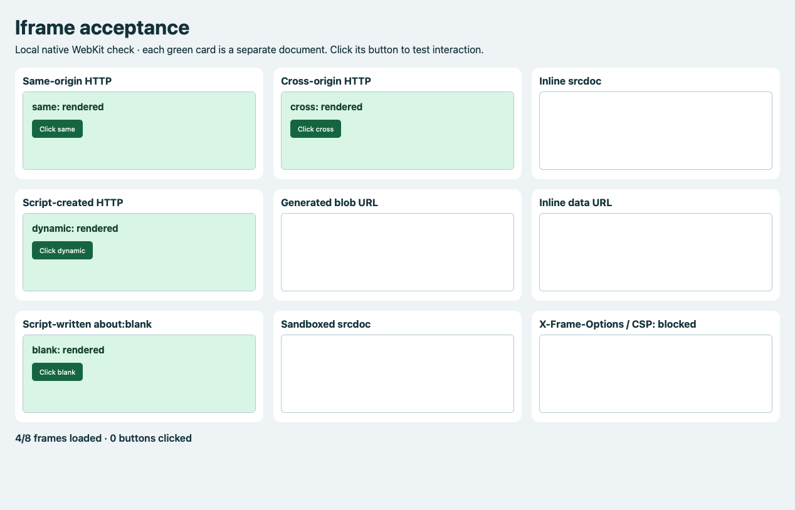
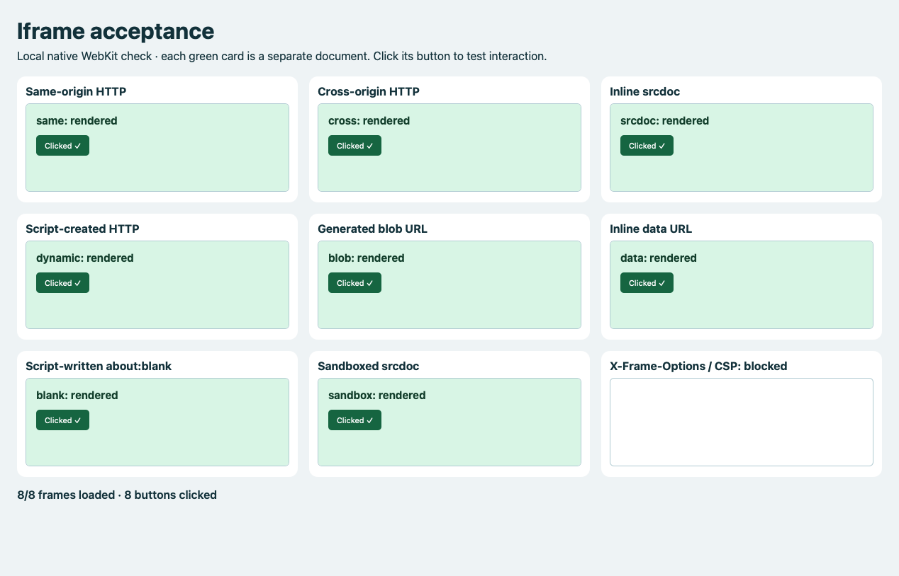

# macOS iframe regression

The local fixture reproduced blank embedded documents in the native Axolotl
WKWebView. Same-origin HTTP, cross-origin HTTP, script-created HTTP and
script-written `about:blank` worked. `srcdoc`, `blob:`, `data:` and sandboxed
`srcdoc` were blank: **4/8** working cases before the fix.

Wry 0.55.1 calls the same URL-only navigation handler for main frames and
subframes. Axolotl's top-level allowlist rejected those embedded document URLs.
The existing macOS navigation-delegate proxy now permits the additional document
types only when `WKNavigationAction.targetFrame` is an existing child frame.
Main-frame targets, new windows, downloads and ordinary HTTP navigation retain
their existing handling. Privileged browser UI does not use this proxy.

After the fix, **8/8** frames render and **8/8** buttons receive trusted native
AppKit clicks. The regression also verifies that cross-origin DOM access and
sandbox origin access fail, a page carrying `X-Frame-Options: DENY` and CSP
`frame-ancestors 'none'` remains blocked, and a child-frame link targeting `_top`
cannot navigate the top-level document to a blob URL.

These are actual WKWebView snapshots captured inside the native app. They show
the web content area, excluding browser chrome. Clicks use the existing AppKit
test helper and WebKit hit testing; this is not physical OS mouse automation.

| Before | After |
| --- | --- |
|  |  |

## Reproduce

```sh
cargo build -p axolotl --locked --features smoke
AXOLOTL_IFRAME_SNAPSHOT=/tmp/axolotl-iframes.png \
  target/debug/axolotl --smoke-test --smoke-iframes
```

The smoke test serves `crates/desktop/assets/smoke-iframes.html` and its child
documents on two temporary loopback origins. It needs a macOS GUI session,
uses the smoke test's isolated profile, and makes no external network requests
for the fixture. Content protection stays enabled.

Sites may deliberately refuse embedding with X-Frame-Options or CSP; those
restrictions remain enforced. Windows behavior has not been tested by this
macOS regression.

## Validation (2026-11-06)

- `cargo test --workspace --locked`: 139 tests passed.
- `cargo clippy --workspace --all-targets --all-features --locked -- -D warnings`: passed.
- `cargo fmt --all -- --check` and `git diff --check`: passed.
- Native `--smoke-iframes`: passed, including trusted clicks and top-level target policy.
- Native `--smoke-downloads`: passed, including blob downloads and download delegate callbacks.
- Native `--smoke-history`: passed, including subframe exclusion, redirects and Back/Forward.
- Native `--smoke-oauth`: failed with `Native popup condition failed: child.closed`.
  The unchanged base (`5493dfee8a962fa165e4cc1512a3d3713e59491a`), built separately
  from a clean Git archive and run with the same flags, fails with the identical
  error. This existing popup-close failure is outside the iframe fix.
