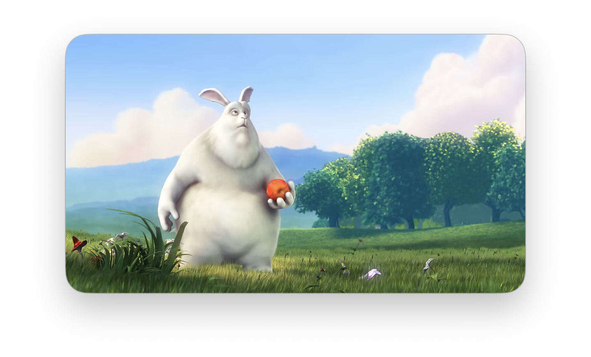

# Native automatic Picture in Picture (macOS)

Axolotl requests WebKit's video presentation mode when an in-app tab or space
switch hides a playing video's tab. It does not use window activation,
minimization, or document visibility events as triggers. Returning to the tab
leaves PiP open. Closing PiP suppresses another request until the tab becomes
visible and is hidden again. The largest eligible playing video in the outgoing
main document is selected; an existing tracked PiP session is left alone.

This uses Wry's public `evaluate_script` path and
`video.webkitSetPresentationMode('picture-in-picture')`. WebKit's public
`evaluateJavaScript:completionHandler:` supplies a user-gesture context, so no
fresh click inside the page is necessary for this host-driven operation. This
was verified with live YouTube in the application's WKWebView on macOS 27.0.1
(26A434), Wry 0.55.1. It is not a claim that a normal page visibility listener can
bypass browser activation requirements.

Reference: [WebKit WKWebView implementation](https://github.com/WebKit/WebKit/blob/main/Source/WebKit/UIProcess/API/Cocoa/WKWebView.mm)
(`evaluateJavaScript:completionHandler:` passes `forceUserGesture:YES`).

There is no floating app window, DOM restyling, video stream extraction,
mutation observer, or repeating media polling timer. Media presentation events
track ownership. One 1.5-second timeout releases a silently rejected request.
The host uses logical tab visibility, so a dismissal cannot be retried by a
render or an unrelated application becoming active. Closing or navigating the
source releases ownership. A source retained for a download is asked to exit
PiP before retirement.

## Reproduction

```sh
cargo build -p axolotl --features smoke --locked
node scripts/test-native-pip.cjs
target/debug/axolotl --smoke-test --smoke-native-pip
```

The native test requires network access to YouTube and a macOS GUI session. It
uses an ephemeral smoke session, mutes playback, and does not modify the user's
saved browser session. `AXOLOTL_PIP_HOLD=1` holds the final PiP state for visual
inspection before closing its source. Test output reports two 10-second samples
of **host-process CPU**, playback time, and the video's frame counters.
WebKit WebContent/GPU process CPU is not included; these samples cannot establish
total browser overhead or improvement over the removed custom-window approach.

## Boundaries

- YouTube's main-document HTML video is the validated target. Cross-origin
  iframe players and shadow-root video discovery are not implemented.
- “Space” means an Axolotl workspace, not a macOS desktop Space.
- WebKit/site restrictions may prevent a request. Failure releases ownership;
  it does not restore the old workaround or continuously retry.
- The automated dismissal test calls the native presentation API to leave PiP;
  it is distinct from clicking the system close control.

Visual capture of the actual macOS system PiP window:



## Validation on 2026-11-06

Final live suite: **passed** in 76.6 seconds. Covered automatic tab entry,
continued hidden playback, three return/hide cycles, native-API dismissal with
no reopen on render, showing then hiding via a new space to rearm, and source
closure removing the WKWebView. [Raw output](native-pip-evidence/validation.log).
Policy checks cover largest playing selection, paused/ended/disabled exclusions,
existing PiP, rejected requests, unrelated presentation changes, and duplicate
exit events. `cargo check -p axolotl --features smoke --locked`, the smoke build,
and 52 workspace-core tests passed.

| Sample | Wall time | Host CPU (one core = 100%) | Video frames advanced | Dropped frames added |
| --- | ---: | ---: | ---: | ---: |
| Inline | 10.17 s | 2.32% | 605 | 0 |
| Hidden native PiP | 10.09 s | 2.11% | 602 | 0 |

These are single sequential samples from a debug build on an active desktop.
They do not measure WebKit/GPU CPU, establish incremental feature overhead, or
compare against the old implementation. No stalling was detected by playback
time advancement in the hidden-PiP check. The captured system PiP image shows
video content, not a blank surface; page styling and parentage are untouched.

Earlier exploratory runs included an unexpected PiP exit/re-entry failure;
the final revised implementation passed the full sequence. A long reliability
soak was not performed. A real system close-button click was attempted during
the visual hold, but the following accessibility query timed out, so that click
is **not** counted as a separately verified dismissal/rearm sequence. Explicit
OS minimize/app-switch interaction tests were not run; those events are absent
from the triggering path. Main-document YouTube is covered; iframe players and
other macOS/WebKit versions remain unverified.
