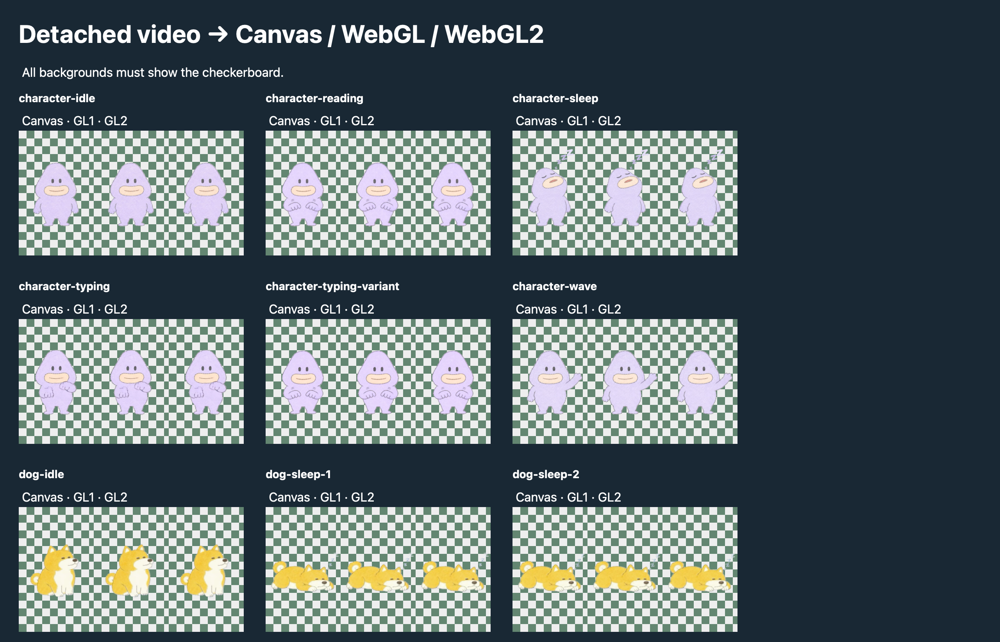

# Transparent WebM on macOS

WKWebView decodes the color stream of VP8/VP9 WebM, but drops its separate
`BlockAdditional` alpha stream. A transparent WebView background cannot repair
those already opaque video pixels. See [WebKit issue 275908](https://bugs.webkit.org/show_bug.cgi?id=275908)
and the [WebM alpha design](https://wiki.webmproject.org/alpha-channel).

Axolotl injects a bundled libvpx alpha decoder into macOS page documents and
subframes. It works on both HTTP and HTTPS without changing secure-context
policy or requiring WebCodecs. DOM video elements receive CSS masks.

The office scene in the reported screenshot uses detached videos as Three.js
textures. A CSS mask cannot affect that path. Axolotl now also wraps video-source
uploads to Canvas2D, WebGL and WebGL2, composing the original color frame with
its alpha mask before upload. `drawImage`, `createPattern`, `createImageBitmap`,
and WebGL texture image/subimage overloads preserve their other arguments and
native behavior for non-video sources. These wrappers run in page documents;
video-to-texture operations in workers are not intercepted.

The original video still owns audio, events, seeking, playback speed, autoplay
and looping. There is no engine replacement, native executable dependency,
runtime download, or external service. Windows retains native WebView2 playback.

Repeated URLs share decoded masks. Only a small cache of decoded PNG masks and
a pair of RGBA canvases per active video are retained; compressed masks have a
separate bounded budget. Color is captured before asynchronously decoding its
mask, so both belong to the same frame. Texture output can lag native playback
by a frame during mask decoding. Decoders run serially and yield between batches
to avoid allocating many WASM heaps simultaneously.

Detached videos are tracked weakly and release resources on source reset,
page teardown or garbage collection. Removing an attached video restores its
original mask styles. Native controls remain unmasked; texture consumers can
still receive alpha. A native alpha readback check avoids double application
when WebKit already exposes transparency.

## Compatibility boundary

This fallback targets animation assets like the supplied character screenshot.
It is deliberately bounded; it is not a general streaming video decoder.

- Requires WebAssembly; bundled single-threaded VP8/VP9 decoders support HTTP.
- Sources must be same-origin or fetchable under the page's CORS and CSP rules.
  CSP must permit WebAssembly compilation and `data:` images for generated masks. No privileged network
  proxy or cross-origin bypass is introduced.
- Recognizes `.webm` URLs, WebM `<source type>` declarations, and blob/data sources.
  MediaSource streams, unknown-size streaming clusters, laced alpha blocks,
  extensionless URLs without a WebM source type are not supported. Detached
  and shadow-root video sources are discovered through playback and uploads.
- DOM videos with native controls or existing CSS masks retain native rendering.
  Masking an element also masks its decorations, so authors should place borders,
  backgrounds and other decorations on a wrapper.
- Maximum source size: 32 MiB. Maximum alpha frame: 4 megapixels. Maximum per
  source: 600 frames and 64 million cumulative frame pixels. At most 16 unique
  sources and 256 million cumulative pixels per document, with a shared 64 MiB
  budget for mask strings. These are work/memory limits, not a video duration limit.
- The video retains native rendering until the finite source has been downloaded
  and its masks decoded. Unsupported or inaccessible sources keep native playback.

## Validation

```sh
node --test scripts/test-webm-alpha.cjs
cargo build -p axolotl --locked --features smoke
python3 scripts/test-webm-alpha.py target/debug/axolotl
# Optional real office artwork from a local Raft checkout:
AXOLOTL_REAL_VIDEO_DIR=/path/to/raft/client/public/office-assets/optimized/video \
  python3 scripts/test-webm-alpha.py target/debug/axolotl
# To verify insecure HTTP, bind to this machine's LAN address:
AXOLOTL_VIDEO_TEST_HOST=<LAN-IP> AXOLOTL_VIDEO_REQUIRE_INSECURE=1 \
  python3 scripts/test-webm-alpha.py target/debug/axolotl
```

The Python runner starts a temporary localhost HTTP server and launches real
Axolotl processes with isolated profiles. The baseline disables only this shim
in the smoke build. Fixtures are original 160x120, 12 fps, two-second animations;
`crates/desktop/assets/video-fixture/generate.py` regenerates them with Pillow
and FFmpeg (neither is needed at runtime).

Verified on macOS 27.0.1:

- Baseline VP8/VP9 videos render black backgrounds. Native canvas readback gives
  alpha 255 for a transparent corner.
- With the fallback, VP8/VP9 mask samples give transparent corners, opaque pink,
  and approximately 50% alpha in the blue rectangle.
- Actual WKWebView snapshots visually show the checkerboard around the circle
  and through the rectangle. MP4 retains its opaque background and native controls.
- Seeking changes the mask; repeated sources acquire shared masks; replacing a
  WebM source with MP4 clears its mask.
- All nine real office character/dog clips render transparent backgrounds through
  detached-video Canvas2D, WebGL and WebGL2 uploads, using both texture allocation
  and subimage updates. This includes the 193-frame reading clip rejected by the
  previous cap. The real artwork remains in its owning Raft repository.
- The same real-asset regression also runs over non-loopback HTTP and asserts
  `isSecureContext === false`. Software-decoder tests do not require WebCodecs.
- The foreground native run verified VP8, VP9 and MP4 playback across the
  two-second loop boundary, observing each currentTime wrap. The runner raises
  its short-lived window above ordinary development windows to avoid autoplay
  occlusion. If the OS still reports the document hidden, it explicitly skips
  continuous timing checks while retaining the decode, alpha and seek checks.

Before (native WebKit):


After (Axolotl fallback):


Real detached-video texture uploads in native Axolotl (each trio: Canvas2D,
WebGL, WebGL2):


