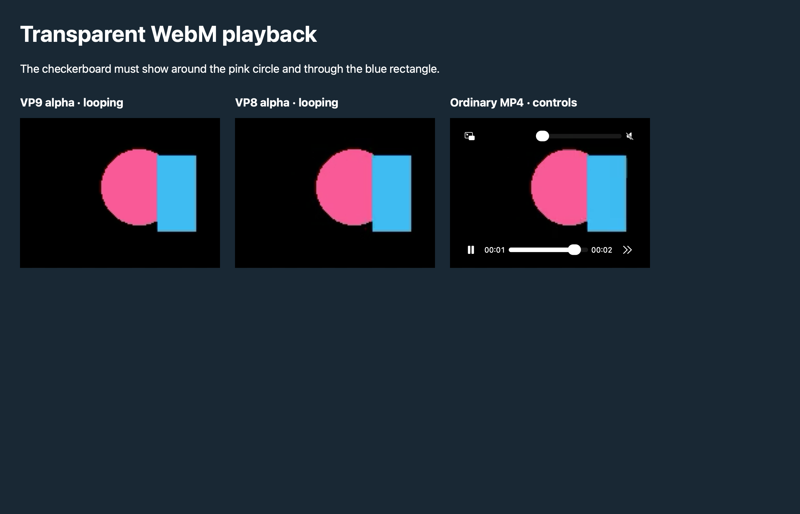
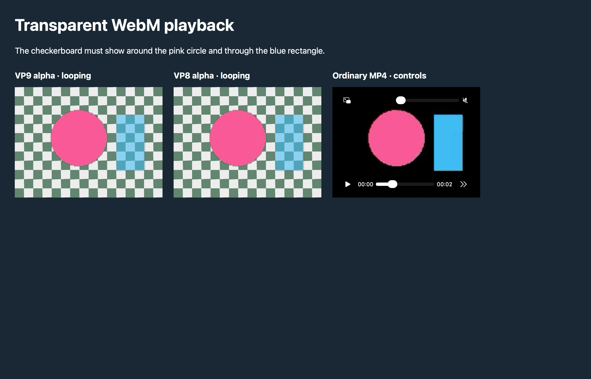

# Transparent WebM on macOS

WKWebView decodes the color stream of VP8/VP9 WebM, but drops its separate
`BlockAdditional` alpha stream. A transparent WebView background cannot repair
those already opaque video pixels. See [WebKit issue 275908](https://bugs.webkit.org/show_bug.cgi?id=275908)
and the [WebM alpha design](https://wiki.webmproject.org/alpha-channel).

Axolotl injects `webm-alpha.js` into macOS page documents and subframes. For
finite, decorative WebM videos it extracts and decodes the alpha stream with
WebCodecs, builds CSS masks, and selects the mask using the original video's
presented frame timestamps. The original video element continues to own color,
audio, layout, events, seeking, playback speed, autoplay and looping. There is
no engine replacement, external service, executable dependency, or page API
prototype patch. Windows retains native WebView2 playback.

Masks are shared by repeated source URLs within each document. Detaching a video,
changing its source, enabling controls, or leaving the page releases its masks
and restores its original inline mask properties. BFCache restoration reattaches
loaded videos. A native alpha readback check avoids masking a frame that already
contains transparency on a future WebKit version.

## Compatibility boundary

This fallback targets animation assets like the supplied character screenshot.
It is deliberately bounded; it is not a general streaming video decoder.

- Requires a secure context with WebCodecs decoding for the source codec.
- Sources must be same-origin or fetchable under the page's CORS and CSP rules.
  CSP must allow `data:` images for the generated masks. No privileged network
  proxy or cross-origin bypass is introduced.
- Recognizes `.webm` URLs, WebM `<source type>` declarations, and blob/data sources.
  MediaSource streams, unknown-size streaming clusters, laced alpha blocks,
  shadow-root videos, and extensionless URLs without a WebM source type are not
  supported.
- Videos with native controls or existing CSS masks retain native rendering.
  Masking an element also masks its decorations, so authors should place borders,
  backgrounds and other decorations on a wrapper.
- Maximum source size: 32 MiB. Maximum alpha frame: 4 megapixels. Maximum per
  source: 600 frames and 32 million cumulative frame pixels. At most four unique
  sources and 128 million cumulative pixels per document, with a shared 32 MiB
  budget for mask strings. These are work/memory limits, not a video duration limit.
- The video retains native rendering until the finite source has been downloaded
  and its masks decoded. Unsupported or inaccessible sources keep native playback.
- The mask changes displayed page compositing; `canvas.drawImage(video)` still
  reads the native color-only stream. Canvas consumers need their own alpha support.

## Validation

```sh
node --test scripts/test-webm-alpha.cjs
cargo build -p axolotl --locked --features smoke
python3 scripts/test-webm-alpha.py target/debug/axolotl
```

The Python runner starts a temporary localhost HTTP server and launches real
Axolotl processes with isolated profiles. The baseline disables only this shim
in the smoke build. Fixtures are original 160x120, 12 fps, two-second animations;
`crates/desktop/assets/video-fixture/generate.py` regenerates them with Pillow
and FFmpeg (neither is needed at runtime).

Verified on macOS 27.0.1:

- Baseline VP8/VP9 videos render black backgrounds. Native canvas readback gives
  alpha 255 for a transparent corner.
- With the fallback, VP8/VP9 mask samples give transparent corners, opaque pink,
  and approximately 50% alpha in the blue rectangle.
- Actual WKWebView snapshots visually show the checkerboard around the circle
  and through the rectangle. MP4 retains its opaque background and native controls.
- Seeking changes the mask; repeated sources acquire shared masks; replacing a
  WebM source with MP4 clears its mask.
- The foreground native run verified VP8, VP9 and MP4 playback across the
  two-second loop boundary, observing each currentTime wrap. The runner raises
  its short-lived window above ordinary development windows to avoid autoplay
  occlusion. If the OS still reports the document hidden, it explicitly skips
  continuous timing checks while retaining the decode, alpha and seek checks.

Before (native WebKit):



After (Axolotl fallback):


